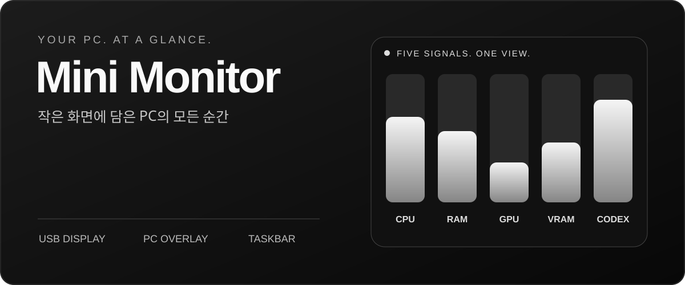
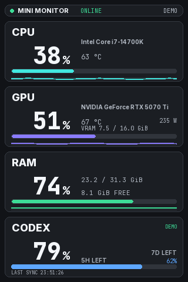

  

<h1 align="center">Mini Monitor</h1>

  <strong>작은 화면으로 확인하는 PC 상태와 Codex 사용량</strong> 
  미니 모니터, PC 상태창, 작업표시줄에서 필요한 정보만 확인하세요.

  
  
  

  <a href="#빠르게-시작하기">설치하기</a> ·
  <a href="https://github.com/contentriumkorea/mini-monitor/releases/latest">다운로드</a> ·
  <a href="#사용-모습">사용 모습</a> ·
  <a href="README_KO.md">상세 안내</a>

---

## 빠르게 시작하기

Windows 10/11 x64용입니다. 설치형은 인터넷 연결이 필요합니다.

  
  

**설치형:** 약 474 KB 설치파일 실행 → 기존 앱 종료 → 설치 / 갱신 → 실행 
**포터블:** ZIP 전체 압축 해제 → `Mini-Monitor` 폴더의 `Mini-Monitor.exe` 실행

[상세 설치 및 업데이트 안내 →](README_KO.md)

## 원하는 곳에서, 필요한 정보만

| 01 · 미니 모니터 | 02 · PC 상태창 | 03 · 작업표시줄 바 |
| :--- | :--- | :--- |
| **작은 화면도 또렷하게** | **작업 공간에 맞게** | **선택한 정보만 간결하게** |
| CPU·RAM·GPU·VRAM·CODEX의 큰 숫자와 세로 게이지. 방향·회전·밝기를 조절합니다. | 위치·크기·배경 투명도를 조절합니다. 숫자와 글자는 선명하게 유지합니다. | 항목별 선택과 아이콘·텍스트 표시. 좌우 위치를 조절하고 전체화면 사용 중에는 숨깁니다. |

## 사용 모습

  

**한 화면에서 보는 하드웨어 상태와 남은 Codex 사용량.**

앱에서 생성한 **합성 수치 예시**입니다. 실제 계정 잔액이나 USB 화면 촬영본이 아닙니다. 상단 커버의 게이지 역시 소개용 그래픽입니다.

<strong>세로 화면과 추가 사용 예시 보기</strong>

USB 모니터를 시작하지 않아도 PC 상태창·작업표시줄 바의 값은 갱신됩니다. Codex 한도가 실제로 소진되고 크레딧이 남아 있으면 `60,518 Credit`처럼 잔액을 표시합니다. 잔액이 없으면 `0%`를 유지합니다.

## 설치형과 포터블, 업데이트

| 방식 | 사용 방법 |
| :--- | :--- |
| **경량 설치기** | 실행 시 최신 정식 앱을 내려받아 검증하고 설치합니다. 바탕화면 바로가기는 기본 선택되며 시작 메뉴·앱 제거 목록에 등록합니다. |
| **최신 앱 본체** | 설치기가 받는 검증된 프로그램 패키지입니다. 설치기와 앱 버전은 별도로 관리합니다. |
| **포터블 ZIP** | 같은 정식 앱의 전체 실행 폴더입니다. 설치 없이 실행하며 EXE만 따로 옮기지 마세요. 설정·로그인은 ZIP 옆이 아닌 현재 Windows 사용자의 앱 데이터 폴더에 저장됩니다. |
| **앱 업데이트** | 새 버전을 알리고 사용자가 선택하면 적용합니다. 이후 앱 업데이트마다 설치기를 다시 받을 필요는 없습니다. |

현재 앱은 **0.2.11**, 설치기는 **1.1.0**입니다. 설치기는 특정 앱 버전에 고정되지 않습니다. 로그인·설정·자동 실행 선택은 보존합니다.

## 이렇게 사용하세요

1. **PC에서 보기:** 설정창 상단에서 PC 상태창 또는 작업표시줄 바를 켭니다.
2. **USB 화면으로 보기:** 지원 장치를 연결하고 방향·밝기를 선택한 뒤 모니터 시작을 누릅니다.
3. **Codex 확인:** 앱의 ChatGPT로 로그인에서 인증합니다. 다른 앱의 인증 자료나 로컬 사용 기록은 읽지 않습니다.
4. **창 관리:** 설정창은 작업표시줄에 고정할 수 있습니다. 트레이 메뉴에서 설정 열기·완전 종료를 선택합니다.

## 적용 범위와 제한

- 지원 USB 장치와 센서에 따라 표시 가능한 정보가 다릅니다. USB 없이 PC 화면만 사용할 수도 있습니다.
- 확인되지 않는 값은 `--` 또는 확인 불가로 표시하며 0으로 추측하지 않습니다.
- 실행파일에는 Windows 게시자 코드 서명이 없어 경고가 나타날 수 있습니다. 파일 검증과 Windows 게시자 확인은 별개입니다.
- 모든 고배율 노트북·전체화면 게임 조합에서 검증된 것은 아닙니다.
- **0.2.6 이하 구버전은 기존 업데이트를 반복하지 마세요.** 앱을 종료하고 최신 설치파일을 사용하되, 기존 프로그램·복구 백업·로그인·설정을 먼저 삭제하지 마세요.

<strong>상세 안내와 검증 범위</strong>

[사용·제거 안내](README_KO.md) · [최신 변경사항](https://github.com/contentriumkorea/mini-monitor/releases/latest) · [문제 신고](https://github.com/contentriumkorea/mini-monitor/issues)

새 설치기의 실제 다운로드·설치·실행·재설치·복구·제거를 Windows 검증 환경에서 확인했습니다. 사용자 PC에서는 설치·로그인 유지와 작업표시줄 고정·트레이 열기·종료를 확인했습니다. 다른 모든 PC의 동작을 보장하는 의미는 아닙니다.

제거할 때는 앱을 완전히 종료한 후 Windows의 설치된 앱에서 Mini Monitor를 제거합니다. 프로그램·등록 정보·생성한 바로가기를 정리하며 로그인·개인 설정은 보존합니다. 수정 파일이나 사용자 파일이 있으면 안전을 위해 제거를 중단할 수 있습니다.

<strong>English overview</strong>

Mini Monitor displays CPU, RAM, GPU, VRAM and Codex account usage on a supported USB display, desktop overlay or taskbar bar. Use the lightweight online installer or extract the complete portable ZIP. Windows 10/11 x64 is supported. Settings and sign-in data are stored per Windows user, not beside the portable executable. This is an independent project, not an official OpenAI product.

---

  <strong>CONTENTRIUM · 콘텐츠리움</strong> 
  <a href="LICENSE">GPL-3.0-or-later</a> ·
  <a href="https://github.com/contentriumkorea/mini-monitor/releases/latest">Latest release</a>

OpenAI 공식 제품이 아닌 독립 프로그램입니다. 제3자 권리와 고지는 유지됩니다.

[제3자 고지](THIRD_PARTY_NOTICES.md) · [구성요소별 라이선스](LICENSES/) · [소스 제공 안내](SOURCE-OFFER.md)

  

