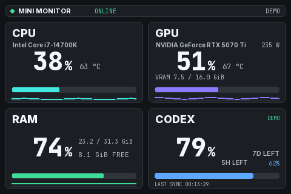

# Mini Monitor

## [Windows 설치파일 다운로드 · 474 KB](https://github.com/contentriumkorea/mini-monitor/releases/download/installer-v1/Mini-Monitor-Setup.exe)

**설치파일 다운로드 → 실행 → 설치 → Mini Monitor 실행**

Windows 10/11 64비트용 **경량 온라인 설치 프로그램**입니다. 이 작은 설치파일 하나를 보관해 두면, 실행할 때마다 최신 정식 버전을 자동으로 찾아 설치하거나 업데이트합니다. 인터넷 연결이 필요하며 앱 본체는 설치 중 별도로 내려받습니다. 기존 Mini Monitor를 먼저 종료하세요. 시작 메뉴·앱 제거 목록에 등록하고 설정·로그인을 보존합니다. 실행파일은 미서명입니다.

**설치기와 앱 업데이트는 별도로 배포합니다.** 설치기는 `installer-v1`의 고정 파일이며, 이후 앱 릴리스에는 프로그램 ZIP·서명된 파일 목록·서명 파일만 배포합니다. 설치기 자체의 보안·호환성 수정이 아닌 한 설치파일을 다시 만들지 않습니다. 이미 최신 앱이면 설치기로 동일 버전을 다시 설치해 등록을 복구할 수도 있습니다.

[포터블 ZIP 다운로드](https://github.com/contentriumkorea/mini-monitor/releases/latest/download/Mini-Monitor.zip)는 직접 압축 해제하는 사용자를 위한 앱 본체입니다. 폴더 전체가 필요하며 EXE만 따로 옮기면 실행되지 않습니다. 현재 앱 버전은 0.2.10으로 유지되므로, 이미 0.2.10이면 새 앱 업데이트 알림은 없습니다. 과거 v0.2.10 릴리스의 대용량 Setup은 이전 오프라인 설치기입니다. **새 설치는 위의 474 KB 링크를 사용하세요.**

[한국어 설치·사용 안내](README_KO.md) · [최신 버전 및 변경사항](https://github.com/contentriumkorea/mini-monitor/releases/latest)

---

Version 0.2.10 uses a taskbar-only native Win32 window. Fonts and PNG icons are rendered directly at the primary taskbar DPI, including 150%, 200% and 250% scaling. The bar hides while a foreground fullscreen app covers that monitor, the taskbar is auto-hidden, Explorer is unavailable, or the safe taskbar area is too small. Its enabled setting and sampling remain active; it resumes with current readings without taking keyboard focus. Fullscreen apps on another monitor do not unnecessarily hide the primary bar. Display changes preserve the relative horizontal position. Setup, account sign-in, USB output and the PC overlay retain their existing behavior.

Automated DPI/shell-state tests and isolated real Windows focus/lifetime tests cover these rules. They do not establish physical validation on every 4K laptop or fullscreen game; verify those environments after updating. This release does not change Windows scaling settings or modify Explorer.

Version 0.2.8 automatically recycles hash-verified previous-version backups and completed update staging folders after the new app starts successfully and the update helper releases its lock. There is no cleanup button. Existing known shortcuts and opted-in startup paths are repaired first; disabled startup stays disabled. Settings/sign-in data, failed recovery backups, unknown folders and trees containing user files remain untouched. Cleanup failures are retried on a later healthy launch; the Recycle Bin is not emptied.

Mini Monitor is an independent, unofficial GPL-3.0-or-later Windows dashboard, not an OpenAI product. It supports a 3.5-inch USB serial display and an optional desktop overlay. Five cards show CPU, RAM, GPU, VRAM and Codex account limits in 480×320 landscape (2+2+1) or 320×480 portrait orientation. Each card has a right-side gauge that fills upward; waveform graphs and duplicate bottom bars are omitted for readability.

[한국어 설치·사용 안내](README_KO.md) · [Releases](https://github.com/contentriumkorea/mini-monitor/releases) · [Source offer](SOURCE-OFFER.md) · [Test results](TEST_RESULTS.md)

AI data uses Codex account sign-in only. Local session scanning, API organization usage and foreground-app activity collection are no longer offered. Credit balance is shown separately from quota remaining; unavailable balances are never inferred as zero. Setup uses a neutral black/gray palette; the small display emphasizes VRAM and omits status badge text.

The optional draggable taskbar bar shows CPU, RAM, GPU, VRAM and Codex as PNG icons plus percentages, with a fully transparent background and opaque readouts. The app starts shared local hardware collection independently of USB transmission, so the setup preview, desktop overlay and taskbar bar work without USB Start. USB Start/Stop controls only the physical mini monitor; desktop readings continue after USB Stop. Codex uses the same account snapshot as setup. It is an independent overlay, not an Explorer/taskbar modification.

Taskbar settings let you select individual metrics (at least one), using icons, text labels, or both. Preferences persist across restarts. Placement avoids the primary taskbar notification area when restoring, dragging, or resizing the bar.

On Windows, the bar docks to the actual primary taskbar and stays left of its notification area. Display and shell geometry changes are checked even when readings are unchanged. The horizontal slider covers only the safe taskbar range; arrow buttons fine-tune by one pixel and reset restores the shell-anchored position. Position changes save immediately, independently of metric selection Apply/Cancel, and do not turn on a hidden bar.

If clicking the Windows taskbar promotes it above the readout, the next UI poll restores the readout immediately above the taskbar, retaining existing popup order, keyboard focus, position and size. This does not require a taskbar transparency utility and never changes Explorer's windows. A user-hidden bar remains hidden.

Setup opens at approximately 960×720 with compact device and account controls. Updates open separately; obsolete CLI selection, installation help, and connection-troubleshooting buttons have been removed because account sign-in uses the bundled runtime. Login errors are shown directly in the account card. Internal scrolling remains a fallback for small screens and high display scaling.

**Upgrade from 0.2.6 or earlier manually:** the old bundled updater can partially move the installed directory when a file is in use. Publishing a new archive cannot replace a helper already running in an older client. Exit the old app and extract the entire 0.2.7-or-newer ZIP into a fresh folder; do not repeat the old in-app update. Preserve the old program, backup folders and `%LOCALAPPDATA%\AI-Mini-Monitor` settings/sign-in data. Adjust shortcuts or startup paths if the executable location changes. Version 0.2.7 uses atomic same-volume directory renames and reports failed recovery accurately. Download/staging checks alone do not establish successful installation or relaunch.

Releases from 0.2.7 use only `update-v2-manifest.json` and `update-v2-manifest.sig`. Legacy clients still notify and link to manual download, but cannot apply these releases with their unsafe helper. Never publish legacy-name metadata aliases: that would re-enable unsafe upgrades, including version skips. Do not apply or retry an already-prepared legacy update; exit the old app before starting the manual baseline installation. A new release does not stop a legacy helper that has already started.

Download the stable `Mini-Monitor.zip` release and keep its entire `Mini-Monitor` folder together. Run `Mini-Monitor.exe` to open setup without starting serial transmission. `Mini-Monitor-CLI.exe` provides read-only diagnostics and synthetic preview generation. The official Codex app-server runtime is included for browser sign-in, so a separate CLI installation is not required. Mini Monitor uses its own login storage and never copies another app's authentication or reads local usage sessions. The Windows executable is not Authenticode-signed; the signed update metadata is a separate integrity mechanism.

Only devices matching USB VID `1A86`, PID `5722` and serial `USB35INCHIPSV2` may receive serial output. An older AI-Mini-Monitor build or the withdrawn 0.2.0 build needs a direct manual baseline upgrade to the latest 0.2.7-or-newer release; 0.2.0 cannot discover this update in-app. Mini Monitor checks for stable updates at startup and periodically while running, with a 24-hour network-check gate; the setup button can check on demand. Applying subsequent v2 updates in 0.2.7 or newer requires an explicit click. Physical USB output and live account login require separate testing on your own hardware/account.

